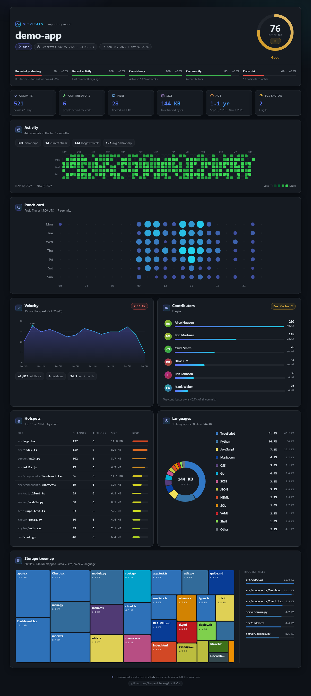

<div align="center">

# 🫀 GitVitals

### Your repository's health report — in one command.

Analyzes **any** Git repo and generates a beautiful, interactive dashboard as a **single, self-contained HTML file**. 100% offline. Zero dependencies. **Never reads your source code.**

[](https://www.npmjs.com/package/gitvitals)
[](LICENSE)
[](https://nodejs.org)
[](package.json)
[](#contributing)

```bash
npx gitvitals
```



</div>

---

## What is this?

GitVitals reads your Git history and file metadata, then hands you a **shareable health report** for your project — the kind of thing you screenshot and drop in your team chat.

> **"Your bus factor is 1."** — GitVitals tells you the uncomfortable truths about your repo, beautifully.

No servers. No accounts. No `pip install` of a scientific stack. No sending your code anywhere. Just `npx gitvitals` and one HTML file you can email, commit, or host.

## ✨ Why GitVitals?

- 🩺 **A health score with a letter grade** — an instant, shareable verdict on your repo (A+ → F), computed from 5 weighted signals.
- 🚌 **Bus factor, front and center** — how many people would have to get hit by a bus before your project stalls? Find out in one glance.
- 🔥 **Actionable hotspots** — the files changed most often, weighted by size: your most likely bug nests and refactor targets.
- 📎 **One attachable file** — the entire interactive dashboard is a single `.html`. It works offline, forever. Share it like an image.
- 🔒 **Privacy by design** — GitVitals **never opens your source files**. It uses only Git metadata (`git log`) and file *sizes*. Enterprise-safe.
- ⚡ **Zero dependencies** — pure Node.js. `npx` runs it instantly with no install tree and no supply-chain risk.

## 📊 The dashboard

| Panel | What it shows |
|---|---|
| **Health gauge** | 0–100 score, letter grade, and the 5 factors behind it |
| **Activity heatmap** | GitHub-style contribution calendar for the last 12 months |
| **Punch card** | When your team works — commits by hour × weekday |
| **Velocity** | Monthly commit trend, additions/deletions, peak month |
| **Contributors** | Leaderboard, ownership share, and **bus factor** |
| **Hotspots** | Highest-risk files ranked by churn × size |
| **Languages** | Donut chart of your codebase by language |
| **Treemap** | Every file sized by bytes, colored by language |

## 🔒 Privacy

GitVitals runs entirely on your machine.

- It **does not read the contents of your source files** — only `git log` metadata and file sizes from the filesystem.
- It makes **no network requests**. The generated report has no CDNs, no external fonts, no telemetry.
- Author **emails are never exported** into the report (used only internally to group contributors).
- The output HTML escapes all user-controlled strings, so a shared report can't carry XSS.

You can open the report on a plane, commit it to your repo, or hand it to your security team.

## 🚀 Quickstart

```bash
# Analyze the repo in the current directory
npx gitvitals

# Analyze a specific repo and open the report
npx gitvitals ~/code/my-app --open

# Save to a custom path, last year only
npx gitvitals . --out reports/my-app.html --since "1 year ago"

# Machine-readable output
npx gitvitals . --json > vitals.json
```

The report is written to `gitvitals-report.html` by default.

## 🛠 Options

```
gitvitals [path] [options]

  path                 Path to a Git repository (default: current directory)
  -o, --out <file>     Output HTML file (default: gitvitals-report.html)
  --open               Open the report in your browser
  --no-open            Don't open a browser (default in CI / non-TTY)
  --json               Print raw analysis as JSON instead of HTML
  --since <date>       Only analyze commits since a date ("6 months ago", 2024-01-01)
  --branch <name>      Analyze a specific branch (default: HEAD)
  --no-color           Disable colored terminal output
  -h, --help           Show help
  -v, --version        Show version
```

## 🧮 How the health score works

A weighted blend of five signals, each scored 0–100:

| Factor | Weight | Rewards |
|---|---|---|
| Knowledge sharing | 25% | A higher bus factor / distributed ownership |
| Recent activity | 25% | Commits in the last days/weeks |
| Consistency | 20% | A high share of active weeks over the repo's life |
| Community | 15% | More contributors |
| Code risk | 15% | Lower churn concentration in hotspots |

Grades: **A+** ≥ 90 · **A** ≥ 80 · **B** ≥ 70 · **C** ≥ 60 · **D** ≥ 50 · **F** < 50.

## 📦 Install

```bash
# Run without installing (recommended)
npx gitvitals

# Or install globally
npm install -g gitvitals

# From source
git clone <this-repo> && cd gitvitals
node bin/gitvitals.js /path/to/repo
```

Requires **Node.js ≥ 18** and **Git** on your PATH. No other dependencies.

## 🎬 Try the demo

This repo ships with a generator that builds a realistic sample repository (≈350 commits, 6 contributors, 12+ languages) and renders a report:

```bash
npm run demo
# → opens demo-report.html
```

A pre-generated report lives at [`docs/demo.html`](docs/demo.html) — open it directly in any browser.

## ⚙️ How it works

1. `git log --numstat` → commits, authors, timestamps, per-file churn.
2. `git ls-files` + `stat` → tracked files and their sizes (no content reads).
3. A pure-JS analysis engine computes every metric.
4. The data is injected into a hand-built HTML/SVG/Canvas template — no framework, no build step, no network.

## 🗺 Roadmap

- [ ] Animated demo GIF and hosted live demo (GitHub Pages)
- [ ] `--compare` two refs / branches side by side
- [ ] `--format json|html|md` and a CI badge endpoint
- [ ] Per-author code ownership (blame-based) heatmap
- [ ] Configurable health-score weights (`.gitvitalsrc`)
- [ ] SVG/PNG export of individual panels

## 🤝 Contributing

PRs welcome! Good first issues are labeled. Please run `npm test` before submitting.

```bash
npm test          # smoke tests (history + empty repo, offline render check)
npm run demo      # build a sample repo and report
```

## 📄 License

[MIT](LICENSE) © GitVitals contributors

<div align="center">
<sub>If GitVitals told you something uncomfortable about your repo, give it a ⭐ — it helps others find it.</sub>
</div>